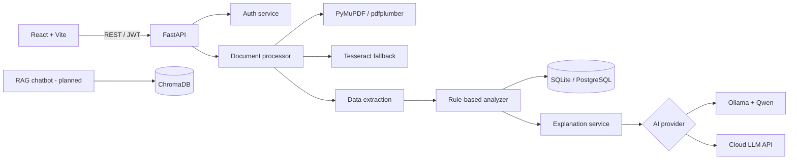

# MediExplain AI

**An Intelligent Medical Report Analysis, Explanation and Health Information Assistant**

MediExplain AI is a full-stack AI application that helps people understand their laboratory reports. It extracts test names, values, units and reference ranges from PDF/image reports, flags values outside the **report's own** reference interval, and explains the findings in plain language (English / Hindi / Hinglish) with an AI assistant grounded in trusted medical references.

> **Medical disclaimer:** MediExplain AI is an educational, informational tool. It is **not** a diagnostic system, does not provide medical advice, and must not replace a qualified healthcare professional. Out-of-range values are **not** a diagnosis. Always discuss results with your doctor.

---

## Table of contents

- [Problem](#problem)
- [Core workflow](#core-workflow)
- [Feature status](#feature-status)
- [Architecture](#architecture)
- [Technology stack](#technology-stack)
- [Repository structure](#repository-structure)
- [Quick start](#quick-start)
- [API overview](#api-overview)
- [Safety and privacy](#safety-and-privacy)
- [Roadmap](#roadmap)
- [Documentation](#documentation)

---

## Problem

Laboratory reports contain technical names, numbers, units and reference ranges that most patients cannot interpret. Reading a value without understanding context can cause unnecessary anxiety or false reassurance. MediExplain AI closes that gap by turning a report into a structured, explainable summary — while keeping the original laboratory values and ranges intact.

## Core workflow

```text
Upload report (PDF / JPG / PNG)
        │
        ▼
Document processing  ── selectable text? ──► PyMuPDF + pdfplumber
        │                                    (scanned → page images → Tesseract OCR)
        ▼
Normalize text → extract test / value / unit / reference range
        │
        ▼
Deterministic analysis engine (LOW / HIGH / NORMAL / UNKNOWN)
        │
        ▼
AI explanation engine (local Ollama + Qwen, optional cloud provider)
        │
        ▼
Dashboard · history · comparison · PDF export
        │
        ▼
Report-grounded chatbot (RAG + citations in Phase 3)
```

## Feature status

| # | Module | Status |
|---|--------|--------|
| 1 | Authentication (JWT, bcrypt) | ✅ Implemented |
| 2 | User dashboard | ✅ Implemented |
| 3 | Report upload (PDF/JPG/PNG) | ✅ Implemented |
| 4 | OCR engine (text + table + OCR fallback) | ✅ Implemented |
| 5 | Structured data extraction | ✅ Implemented (rule-based v1) |
| 6 | Analysis engine (range flags, units, critical flags) | ✅ Implemented |
| 7 | AI explanation engine (Ollama/Qwen + offline fallback) | ✅ Implemented |
| 8 | AI chatbot (report-grounded, safety refusals, offline fallback) | ✅ Implemented |
| 9 | Medical knowledge base (RAG) | ⏳ Planned (Phase 3) |
| 10 | Report history | ✅ Implemented |
| 11 | Report comparison | ⏳ Planned |
| 12 | Export & sharing (PDF) | ⏳ Planned |

Legend: ✅ working code + tests · 🚧 under construction · ⏳ planned.

**Try it now:** run both apps, create an account and upload `samples/sample_cbc_report.pdf`.

## Architecture



Six layers: **frontend → API → processing → analysis → AI → storage**. The AI provider is pluggable, so the app works with a local model or a hosted API without changing business logic.

## Technology stack

| Category | Technology |
|----------|------------|
| Frontend | React + Vite, Tailwind CSS, Recharts, Lucide |
| Backend | Python 3.10+, FastAPI, SQLAlchemy |
| Database | SQLite (development) → PostgreSQL (production) |
| PDF extraction | PyMuPDF, pdfplumber |
| OCR | Tesseract (`pytesseract`) |
| AI inference | Ollama + Qwen (local), optional hosted LLM |
| Embeddings / RAG | Sentence Transformers, ChromaDB, LangChain (Phase 3) |
| Auth | JWT + bcrypt |
| Deployment | Docker / Docker Compose |

## Repository structure

```text
MediExplain/
├── backend/                  # FastAPI service + processing pipeline
│   ├── app/                  # API layer (routes, models, schemas, core)
│   ├── services/             # Document → analysis → explanation pipeline
│   ├── tests/                # Pytest suite
│   └── README.md
├── frontend/                 # React + Vite client (in progress)
├── data/                     # Runtime data (git-ignored)
│   ├── uploads/              # Private uploaded reports
│   ├── processed/            # Optional processed artifacts
│   └── vector_db/            # ChromaDB persistence (Phase 3)
├── samples/                  # Synthetic reports for demos and tests
├── scripts/                  # Sample-report generator
├── docs/                     # Architecture, API, safety notes
├── .env.example
└── README.md
```

## Quick start

### 1. Backend

```powershell
cd backend
python -m venv .venv
.\.venv\Scripts\Activate.ps1
pip install -r requirements.txt
Copy-Item ..\.env.example .env
uvicorn app.main:app --reload --port 8000
```

Open API docs: <http://localhost:8000/docs>

Run tests:

```powershell
cd backend
.\.venv\Scripts\Activate.ps1
pytest -q
```

### 2. AI provider (optional)

Explanations fall back to safe, deterministic templates when no model is available. To enable local AI:

```powershell
ollama serve
ollama pull qwen2.5:3b
```

Set `AI_PROVIDER=ollama` and `OLLAMA_MODEL=qwen2.5:3b` in `backend/.env`. If the model is unavailable, the API degrades gracefully to the template explanations.

### 3. Frontend

```powershell
cd frontend
npm install
Copy-Item .env.example .env
npm run dev
```

Open <http://localhost:5173>. The client expects the API at `http://localhost:8000`
(change `VITE_API_BASE_URL` if needed).

### 4. Synthetic sample reports

```powershell
backend\.venv\Scripts\python.exe scripts\generate_sample_reports.py
```

This creates `samples/sample_cbc_report.pdf` and `samples/sample_lipid_report.pdf`.
All values are fabricated — see [`samples/README.md`](samples/README.md).

## API overview

| Method | Endpoint | Purpose |
|--------|----------|---------|
| `GET` | `/api/health` | Health check |
| `POST` | `/api/auth/register` | Create account |
| `POST` | `/api/auth/login` | Obtain JWT |
| `GET` | `/api/auth/me` | Current user |
| `POST` | `/api/reports/upload` | Upload + process a report |
| `GET` | `/api/reports` | List current user's reports |
| `GET` | `/api/reports/{id}` | Report details + results |
| `GET` | `/api/reports/{id}/results` | Extracted results |
| `POST` | `/api/reports/{id}/analyze` | Re-run deterministic analysis |
| `POST` | `/api/reports/{id}/explain` | Generate AI explanations |
| `DELETE` | `/api/reports/{id}` | Delete report and stored file |

All `/api/reports*` endpoints require `Authorization: Bearer <token>` and enforce per-user ownership.

## Safety and privacy

- Passwords are hashed with **bcrypt**; API access uses **JWT**.
- Every report query is scoped to the authenticated user.
- Uploads are validated by extension **and** file signature, size-limited, and stored outside any public web root.
- The deterministic analysis layer, not the LLM, decides LOW/HIGH/NORMAL. The LLM only explains.
- The LLM is instructed to never invent values, never diagnose, never prescribe, and to surface uncertainty.
- Original laboratory values, units and reference ranges are preserved verbatim.
- A critical-value flag uses a configurable threshold table that **must be clinically validated** before any real deployment.

For an India deployment, review the DPDP framework and applicable medical-device software regulations. A college prototype is not cleared for clinical use.

## Roadmap

**Phase 1 — MVP (complete):** upload PDF → extract CBC values → reference ranges → HIGH/LOW flags → simple explanations.

**Phase 2 — Intelligent app (current):** OCR for scans, Qwen explanations (EN/HI/Hinglish), report chat, history.

**Phase 3 — Advanced:** RAG knowledge base with citations, multi-report comparison, charts, PDF export, provider switching.

See [`docs/ROADMAP.md`](docs/ROADMAP.md) for the 10-week plan and task tracker.

## Documentation

- [`backend/README.md`](backend/README.md) — backend setup, pipeline, endpoints, tests
- [`frontend/README.md`](frontend/README.md) — frontend setup (in progress)
- [`docs/README.md`](docs/README.md) — documentation index
- [`docs/ARCHITECTURE.md`](docs/ARCHITECTURE.md) — system and data-flow design
- [`docs/SAFETY.md`](docs/SAFETY.md) — medical safety and privacy requirements
- [`docs/ROADMAP.md`](docs/ROADMAP.md) — milestones and checklist

---

Built as a B.Tech CSE (AI & ML) major project.
