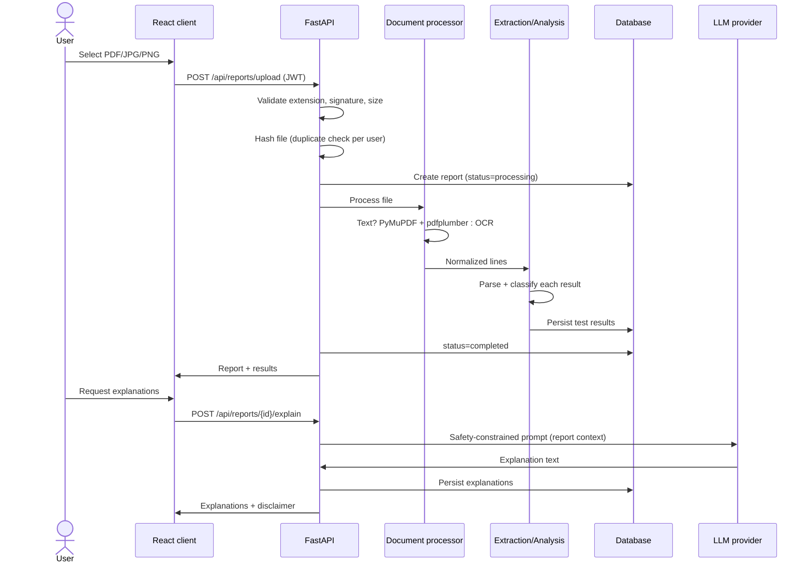
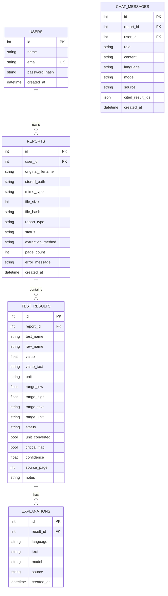

# Architecture

## 1. Layers

| Layer | Technology | Responsibility |
|-------|------------|----------------|
| Frontend | React + Vite | UI, upload, dashboards, chat |
| API | FastAPI | Auth, validation, authorization, orchestration |
| Processing | PyMuPDF, pdfplumber, Tesseract | Text, tables, OCR |
| Analysis | Python (deterministic) | Value/range comparison, flags |
| AI | Ollama + Qwen / hosted LLM | Explanations, chat |
| Storage | SQLite/PostgreSQL + ChromaDB | Metadata, reports, knowledge |

## 2. Upload → analysis flow



## 3. AI provider abstraction

```text
ExplanationService / ChatService
            │
            ▼
       LLMProvider (ABC)
       ├── OllamaProvider  → POST /api/generate
       └── CloudProvider   → OpenAI-compatible /chat/completions
```

Selection is configuration-only (`AI_PROVIDER`). If the configured provider fails, the service returns deterministic template explanations and marks the response `source: "template"` — the app never fabricates a value.

## 4. Database schema (MVP)



Design decisions:

- Original file is stored separately from extracted results.
- The laboratory's units and ranges are preserved; no global default range is applied.
- Extraction confidence and validation status are stored per result.
- `source_page` supports traceability to the original document.
- LLM output is stored in `explanations`, never overwriting `test_results`.
- Chat transcripts are stored per report; the assistant may only use that report's
  extracted results, and diagnosis/prescription requests are refused before the
  model is called.
- Every report query is scoped by `user_id`.

## 5. Error handling

| Failure | Behaviour |
|---------|-----------|
| Corrupt/unreadable PDF | Report `status=failed`, message stored, HTTP 422 |
| Tesseract not installed | Text extraction still works; scanned uploads fail with a clear message |
| Ollama offline | Template explanations/chat, `source=template`, HTTP 200 |
| Duplicate file (same user) | HTTP 409 with existing report id |
| Unauthorized report access | HTTP 404 (does not leak existence) |

## 6. Deployment

Development: React dev server + uvicorn + SQLite + local Ollama.

Production-style: static frontend host, containerised API, PostgreSQL, private object storage, hosted or dedicated-GPU inference. Never expose a development Ollama endpoint publicly.
